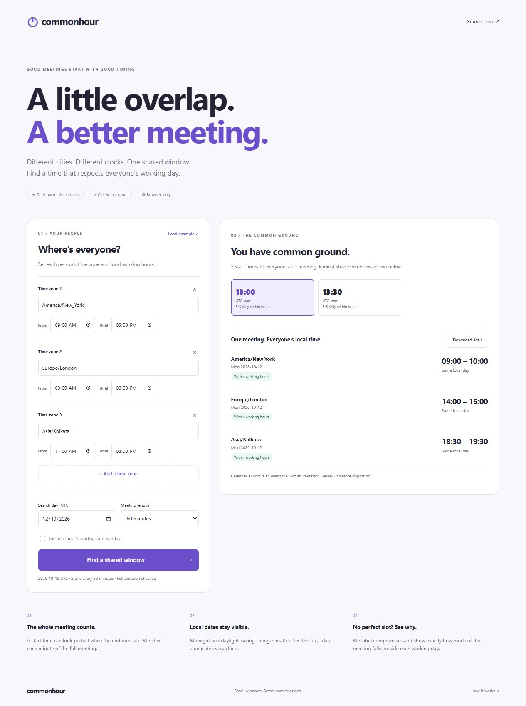

# Commonhour

Find a considerate meeting time across time zones. Set local working hours,
compare full-meeting overlap, and take a calendar event with you.



## Features

- Compare up to six IANA time zones, including fractional-hour offsets.
- Use date-specific daylight-saving offsets from your browser's timezone data.
- Check the entire meeting, in 30, 60, 90 or 120 minute durations.
- Set individual working hours, with support for overnight windows.
- Exclude local weekends or include them with one option.
- Review everyone's local start, end and calendar date.
- See explicit outside-hours labels when there is no full overlap.
- Download an `.ics` event with absolute UTC timestamps.
- Browser-only processing: no accounts, external APIs, tracking or uploads.

## Run locally

Requires Node.js 20 or newer. No package installation is needed.

```sh
npm test
npm run build
npm run preview
```

Open http://127.0.0.1:4174. Choose time zones and local hours, a UTC search day,
and a duration. Select **Find a shared window**, review a slot, and download the
calendar event. The example button resets the planner to a three-city example.

## How it works

The search examines 48 possible UTC starts, spaced 30 minutes apart across the
selected UTC day. Each candidate can finish on the next UTC day. For each person,
the engine converts every minute of the meeting into that person's local time
using `Intl.DateTimeFormat`, then checks the working window and local weekday.
Start times are inclusive and end times exclusive.

Fully fitting slots appear first. If no slot fits everyone, compromises rank by
the number of people whose whole meeting fits, then total minutes inside working
hours, then UTC start. This is an explicit heuristic, not calendar availability.
Overnight windows evaluate weekends by each minute's local calendar day.

The shared engine is in `src/planner.mjs`, the RFC-style calendar export is in
`src/calendar.mjs`, and the interface is plain HTML, CSS and JavaScript under
`public/`. The build copies only product assets and modules into `dist/`.

## Limits

- No calendar integrations, booking, attendees, invitations or reminders.
- Only 30-minute start increments; an overlap at other increments may be missed.
- No holidays, per-day schedules, recurring-meeting checks or stored preferences.
- A UTC search day may cover different local calendar dates; those are displayed.
- Zone rules depend on the browser's installed IANA data, so keep it current.
- Downloaded events contain selected zone names and local-time notes. Review
  compromise slots before importing; the app does not send anything to anyone.

## Deploy

Import this repository into Vercel. `vercel.json` configures `npm run build` and
`dist/` as the static output. No environment variables or paid services are needed.

## Verification

The tests cover DST changes, fractional offsets, weekend boundaries, overnight
hours, full-duration checks, validation, UTC event timestamps and calendar folding.
GitHub Actions checks Node 20/22 on Windows and Linux.
